# B3 登録後報奨 — 実フロー図（mermaid 版）

同じ内容の清書は `svg/` の3枚（JIS 記号で手配置したフローチャート）と `B3_実フロー図.pdf`（A3・3ページ）です。
この mermaid 版は、ほかの LLM に渡して照合する・仕様書の mermaid と突き合わせるためのテキスト版です。
ノード・分岐・出口は SVG 版と1対1で対応させてあります。

- **何を描いたか**：仕様書（改訂3a）の図ではなく、**コードが実際にたどる順序・分岐・出口**。
- **根拠のコード**：`kunonao/houshoukin` ブランチ `b3-registered-after`（コミット `3c4b710`、2026-09-18）。
  `kunonao/houshoukin-project` の `共有用_報奨金算出_20260922/プログラム/` と同じ中身（改行コードだけ違う）。
- **描き方**：ループは戻り矢印ではなく **ループ端（始端・終端）の対** で表す（JIS X 0121 の書き方）。
  mermaid では始端・終端とも同じ形（`notch-pent`）になるので、文字で「ループ始端／ループ終端」と書き分けた。
- **印**：★＝仕様書の mermaid 図には描かれていない実際の処理（本文やコードにはある）。
  ⚠＝技術的な不具合として処理全体を止める（要確認にはならず、結果ブックは保存しない。bat は「異常終了」と表示）。
- **mermaid の版**：新しい記号の書き方（`@{ shape: … }`）を使うため mermaid 11.3 以降が要る。
  共有版に同梱の `assets/mermaid.js`（11.17.2）で3図とも描けることを確認済み。

## 1/3 全体（起動から保存まで）

```mermaid
flowchart TB
    st@{ shape: stadium, label: "開始" }
    m1@{ shape: trap-t, label: "★ [B3-0-1] 当年度の評価ランク付与（K000）を済ませる<br/>（プログラムは確認しない運用上の前提。未完了なら E09 が多数出る）" }
    m2@{ shape: trap-t, label: "TOPAM「登録後報奨」の CSV を1つだけ<br/>入力¥登録後報奨¥ に置く（自動取得でも手作業でも可）" }
    m3@{ shape: trap-t, label: "実行¥b3_登録後報奨を算出.bat を実行する" }
    d1@{ shape: diam, label: "★ 仮想環境・セットアップ合格の記録・<br/>入力 CSV が揃っているか" }
    d2@{ shape: diam, label: "★ 設定.xlsx（今年の設定）が読めるか" }
    m4@{ shape: trap-t, label: "★ 画面の「報奨金支払年」を確かめて Enter" }
    d3@{ shape: diam, label: "★ 結果ブック・設定.xlsx・入力補正マスタを<br/>Excel で開いていないか" }
    pf@{ shape: fr-rect, label: "★ 事前点検（main.py の preflight）<br/>入力補正マスタ／年度から決まる設定／<br/>入力 CSV（1つ・読める・必須の見出し）／金額マスタ" }
    d4@{ shape: diam, label: "★ 不足は無いか" }
    d5@{ shape: diam, label: "★ 「登録後報奨」シートは<br/>まだ無いか（main.py・runner.py）" }
    tnc@{ shape: stadium, label: "理由を表示して終了（計算しない）<br/>終了コード 2（bat 自身の点検は 1）" }
    pr@{ shape: hex, label: "年度から決まる設定を読む<br/>制度対象期間＝前年 1/1〜12/31<br/>評価付与日下限＝前年 12/1（既定）" }
    io1@{ shape: lean-r, label: "★ CSV を「Raw_登録後」シートへそのまま転写" }
    p1@{ shape: rect, label: "★ 取込ログに1行（コード版・金額マスタ版・補正マスタ版）" }
    p2@{ shape: rect, label: "★ Raw を1行ずつ読む<br/>（2回目の各国ユーザ番号・国コード・四法区分コード＝関連出願の親の列）" }
    b0@{ shape: fr-rect, label: "★⚠ [B0] 入力補正（入力補正マスタ.xlsx）<br/>親の関係コード修正 → 親の追加 → 従業員ID の別名 → 受給者の書き換え<br/>記録＝前処理ログ_登録後・Raw の該当セルを着色" }
    p3@{ shape: rect, label: "★ 金額マスタ（評価ランク → 基準報奨金額）を読む" }
    d6@{ shape: diam, label: "★ [N-02] 制度対象期間は<br/>同一年の 1/1〜12/31 か" }
    stop1@{ shape: stadium, label: "⚠ 停止（異常終了。何も保存しない）" }
    p4@{ shape: rect, label: "[B3-0-0] 全行をファミリー番号順に並べる" }

    st --> m1 --> m2 --> m3 --> d1
    d1 -- "はい" --> d2
    d2 -- "はい" --> m4 --> d3
    d3 -- "はい" --> pf --> d4
    d4 -- "はい" --> d5
    d5 -- "はい" --> pr --> io1 --> p1 --> p2 --> b0 --> p3 --> d6
    d6 -- "はい" --> p4
    d1 -- "いいえ" --> tnc
    d2 -- "いいえ" --> tnc
    d3 -- "開いている" --> tnc
    d4 -- "ある" --> tnc
    d5 -- "ある（人の編集を守る）" --> tnc
    d6 -- "いいえ" --> stop1

    lf@{ shape: notch-pent, label: "ループ始端：ファミリーのループ<br/>（ファミリー番号順に1つずつ）" }
    p5@{ shape: rect, label: "★ K000 のランクが無い行を控える（終了時の一覧用。ゲートの結果に関係なく）<br/>処理順（通し番号）を行数ぶん確保する" }
    subgraph gate0["3-0 入力ゲート（ファミリー単位）"]
        g2@{ shape: diam, label: "[B3-0-2] 全行で必須の7項目が空でなく、<br/>発明者関連の3列があるか" }
        g3@{ shape: diam, label: "[B3-0-3] 繰返し項目の要素数が<br/>系列ごとに一致するか" }
        g4@{ shape: diam, label: "[B3-0-4] 全行に K000 の<br/>評価ランクがあるか" }
        g5@{ shape: diam, label: "★ [B3-0-4 続き] K000 の判断日が日付・<br/>ランクが 01〜18・同じ日に別のランクが無いか" }
    end
    eg@{ shape: rect, label: "①に要確認の行を1行（ファミリー単位。C2）<br/>処理順・ファミリー番号・構成案件数・<br/>エラーコード・エラー詳細・到達ブロック＝3-0（支払単位ID は振らない）" }
    p31@{ shape: fr-rect, label: "3-1・3-2 真のH5 の確定と報奨グループの付番（2/3）" }
    lg@{ shape: notch-pent, label: "ループ始端：報奨グループのループ<br/>（ソート順で先に現れるグループから）" }
    p33@{ shape: fr-rect, label: "3-3〜3-8 報奨グループの処理<br/>①を1行・対応表を全案件ぶん作る（3/3）" }
    eg2@{ shape: notch-pent, label: "ループ終端：報奨グループのループ" }
    ef@{ shape: notch-pent, label: "ループ終端：ファミリーのループ" }

    p4 --> lf --> p5 --> g2
    g2 -- "はい" --> g3
    g3 -- "はい" --> g4
    g4 -- "はい" --> g5
    g5 -- "はい" --> p31 --> lg --> p33 --> eg2 --> ef
    g2 -- "いいえ（E01）" --> eg
    g3 -- "いいえ（E02）" --> eg
    g4 -- "いいえ（E09）" --> eg
    g5 -- "いいえ（E01）" --> eg
    eg -- "次のファミリーへ" --> ef

    w1@{ shape: doc, label: "★ ①「登録後報奨」シートを書く<br/>（要確認の行は判断に要る列を薄赤）" }
    w2@{ shape: doc, label: "★ 「登録後_案件対応表」シートを書く<br/>（グループ内の全案件を1行ずつ）" }
    ds@{ shape: curv-trap, label: "★ 件数を表示：正常支給／正常不支給／要確認／ファミリー数／<br/>グループ数／ランク未付与の行／前年評価の疑い" }
    dm@{ shape: diam, label: "[B3-0-4] K000 のランクが無い行が<br/>あったか" }
    am@{ shape: curv-trap, label: "注意：該当行の一覧を表示<br/>（ファミリー番号・各国ユーザ番号・国）" }
    dst@{ shape: diam, label: "★ 前年評価の疑い（採用ランクの判断日<br/>＜評価付与日下限）があったか" }
    ast@{ shape: curv-trap, label: "注意：件数と先頭20件を表示<br/>（①「評価付与日警告」列で絞り込む）" }
    sv@{ shape: rect, label: "★ 安全に保存（バックアップ → 一時ファイル → 置き換え）" }
    te@{ shape: stadium, label: "終了（正常終了）" }
    b6@{ shape: trap-t, label: "後工程 [B6]：①の要確認・注意を人が確認し、TOPAM を直す／入力補正マスタに行を足す<br/>→ 結果シートを消して再実行（そのファミリーは 3-0 からやり直しになる）" }

    ef --> w1 --> w2 --> ds --> dm
    dm -- "あった" --> am --> dst
    dm -- "なし" --> dst
    dst -- "あった" --> ast --> sv
    dst -- "なし" --> sv
    sv --> te -.-> b6

    classDef human fill:#ecfeff,stroke:#0e7490
    classDef dec fill:#fffbeb,stroke:#334155
    classDef predef fill:#eff6ff,stroke:#334155
    classDef loop fill:#f5f3ff,stroke:#334155
    classDef err fill:#fef2f2,stroke:#b91c1c
    classDef stop fill:#fff7ed,stroke:#c2410c,stroke-dasharray:6 4
    classDef ok fill:#ecfdf5,stroke:#047857
    class m1,m2,m3,m4,b6 human
    class d1,d2,d3,d4,d5,d6,g2,g3,g4,g5,dm,dst dec
    class pf,b0,p31,p33 predef
    class lf,lg,eg2,ef loop
    class eg err
    class stop1 stop
    class te ok
```

## 2/3 3-1 真のH5 の確定・3-2 報奨グループの付番（ファミリー単位）

```mermaid
flowchart TB
    s0@{ shape: stadium, label: "開始：3-0 を通ったファミリーの行群（1/3 から）" }
    s11@{ shape: rect, label: "[B3-1-1] ファミリー内を並べる：JP を先頭、次に国コード順、<br/>同じ国コード内は各国ユーザ番号の昇順" }
    s0 --> s11 --> lr

    subgraph p31["3-1 真のH5 の確定"]
        lr@{ shape: notch-pent, label: "ループ始端：行のループ（ファミリーの全行）" }
        s12@{ shape: rect, label: "[B3-1-2] 関連出願の親の各国ユーザ番号(m)と法的関連性コード(m)を<br/>組に分ける（親が無ければ 0 組）" }
        lp@{ shape: notch-pent, label: "ループ始端：親の組のループ" }
        dh5@{ shape: diam, label: "★ 法的関連性コードは<br/>H5（優先権主張）か" }
        djp@{ shape: diam, label: "[B3-1-3] 親の各国ユーザ番号に<br/>「JP-P」を含むか" }
        s15@{ shape: rect, label: "[B3-1-5] 真のH5 の親として残す" }
        skip@{ shape: rect, label: "★ [B3-1-4] ほか：真のH5 に数えない<br/>・H5 以外の関係（04 分割・20・01 など）<br/>・「JP-P」を含む親の H5＝見かけの複合優先（「親子」に読み替えて除外）" }
        ep@{ shape: notch-pent, label: "ループ終端：親の組のループ" }
        s17@{ shape: rect, label: "[B3-1-6]・[B3-1-7] 残った親を並べて「親構成」とする<br/>（0件＝親なし／1件＝単独の親／2件以上＝真の複合優先）" }
        er@{ shape: notch-pent, label: "ループ終端：行のループ" }
        lr --> s12 --> lp --> dh5
        dh5 -- "はい" --> djp
        dh5 -- "いいえ" --> skip
        djp -- "はい" --> skip
        djp -- "いいえ" --> s15
        s15 --> ep
        skip --> ep
        ep --> s17 --> er
    end

    subgraph p32["3-2 報奨グループの付番（B3.2）"]
        prep@{ shape: hex, label: "★ 後回しリスト ← ファミリーの全行（ソート順）<br/>付番済みリスト ← 空" }
        lpass@{ shape: notch-pent, label: "★ ループ始端：パスのループ<br/>（後回しの行が残っている間）" }
        lrow@{ shape: notch-pent, label: "ループ始端：後回しリストの行を上から1行ずつ" }
        d21@{ shape: diam, label: "[B3-2-1] 国コードは JP か" }
        d23@{ shape: diam, label: "[B3-2-3] 真のH5 の親があるか" }
        d24@{ shape: diam, label: "[B3-2-4] 親は1件だけか<br/>（単独の親）" }
        d25@{ shape: diam, label: "[B3-2-5] その親はファミリー内の行か<br/>（JP に限らない）" }
        dasg@{ shape: diam, label: "★ その親は付番済みか" }
        s26@{ shape: rect, label: "[B3-2-6] 親と同じグループを付与" }
        defer@{ shape: rect, label: "★ 後回しにする<br/>（次のパスで決める）" }
        s22@{ shape: rect, label: "[B3-2-2] 新規グループ nJPm を付番" }
        d29@{ shape: diam, label: "[B3-2-9] この案件だけを真のH5 の親とする<br/>JP 案件があるか" }
        s210@{ shape: rect, label: "[B3-2-10] その JP と同じグループを付与<br/>（複数なら各国ユーザ番号の昇順で先頭）" }
        s211a@{ shape: rect, label: "[B3-2-11] 新規グループ nFOm を付番" }
        d27@{ shape: diam, label: "[B3-2-7] 同じ親構成で付番済みの案件があるか<br/>（JP 案件も対象。最初のものを使う）" }
        s28@{ shape: rect, label: "[B3-2-8] その案件と同じグループを付与" }
        s211b@{ shape: rect, label: "[B3-2-11] 新規グループ nFOm を付番" }
        erow@{ shape: notch-pent, label: "ループ終端：後回しリストの行" }
        dstuck@{ shape: diam, label: "★ このパスで1行も決まらなかったか<br/>（親どうしの循環・自分が親など）" }
        force@{ shape: rect, label: "★ 後回しの先頭（ソート順で最上位）の1行だけを後回しせずに決める<br/>（未付番の親は見ずに [B3-2-7] → [B3-2-8]／[B3-2-11]）" }
        epass@{ shape: notch-pent, label: "ループ終端：パスのループ" }

        prep --> lpass --> lrow --> d21
        d21 -- "はい" --> s22
        d21 -- "いいえ" --> d23
        d23 -- "いいえ" --> d29
        d29 -- "はい" --> s210
        d29 -- "いいえ" --> s211a
        d23 -- "はい" --> d24
        d24 -- "はい" --> d25
        d24 -- "いいえ" --> d27
        d25 -- "いいえ" --> d27
        d25 -- "はい" --> dasg
        dasg -- "はい" --> s26
        dasg -- "いいえ" --> defer
        d27 -- "はい" --> s28
        d27 -- "いいえ" --> s211b
        s22 -- "次の行へ" --> erow
        s210 -- "次の行へ" --> erow
        s211a -- "次の行へ" --> erow
        s28 -- "次の行へ" --> erow
        s211b -- "次の行へ" --> erow
        s26 --> erow
        defer --> erow
        erow --> dstuck
        dstuck -- "はい" --> force --> epass
        dstuck -- "いいえ" --> epass
    end

    er --> prep
    sord@{ shape: rect, label: "並びを 3-1-1 のソート順に戻す<br/>（n＝全ファミリー通しの番号、m＝ファミリー内の JP／FO 別の番号）" }
    tend@{ shape: stadium, label: "戻る：各行に報奨グループID（{ファミリー番号}-{n}JP{m}／-{n}FO{m}）<br/>→ 1/3 の「報奨グループのループ」へ" }
    epass --> sord --> tend

    classDef dec fill:#fffbeb,stroke:#334155
    classDef loop fill:#f5f3ff,stroke:#334155
    class dh5,djp,d21,d23,d24,d25,dasg,d29,d27,dstuck dec
    class lr,lp,ep,er,lpass,lrow,erow,epass loop
```

## 3/3 3-3〜3-8 報奨グループの処理（①を1行作る）

```mermaid
flowchart TB
    s0@{ shape: stadium, label: "開始：1つの報奨グループの案件行（ソート順。1/3 から）" }

    subgraph b33["3-3 支払単位の特定"]
        s331@{ shape: rect, label: "[B3-3-1] ①の行を用意する<br/>支払単位ID＝{報奨金支払年}-B3-{グループの連番6桁}<br/>報奨グループID・ファミリー番号・制度対象期間（前年 1/1〜12/31）<br/>処理順＝グループ内の最小・構成案件数" }
        s332@{ shape: rect, label: "⚠ [B3-3-2] 対応表の行を全案件ぶん用意する<br/>案件表示番号＝四法名-登録番号（先頭の 0 を除く。四法区分コードが P・U・D 以外なら⚠）<br/>明細表示本文＝要約→作用効果→請求の範囲→意匠の説明の最初の空でない値" }
        d332@{ shape: diam, label: "[B3-3-2] どれか1案件に<br/>明細表示本文があるか" }
        s331 --> s332 --> d332
    end

    subgraph b34["3-4 採用評価ランクの決定"]
        l4@{ shape: notch-pent, label: "ループ始端：案件のループ（ソート順）" }
        s43@{ shape: rect, label: "[B3-4-3] 案件の評価ランク＝K000 のうち評価判断日が最新のランク<br/>（案件のランク・判断日を対応表へ）" }
        d44a@{ shape: diam, label: "[B3-4-4] 最初の案件か、または<br/>ランクの数字が採用中より小さいか" }
        d44b@{ shape: diam, label: "[B3-4-4 続き] 同じランクで、この案件が JP・<br/>採用中が外国か" }
        s45@{ shape: rect, label: "[B3-4-5] 採用評価ランク・評価採用元・判断日を更新" }
        e4@{ shape: notch-pent, label: "ループ終端：案件のループ" }
        s47@{ shape: rect, label: "★ [B3-4-7] 代表案件＝評価採用元。①に採用評価ランク・判断日・代表案件キー・<br/>四法区分コード・案件表示番号・発明の名称・明細表示本文<br/>（本文は代表案件のもの。空ならグループ内で最初の本文）" }
        dst@{ shape: diam, label: "★ 採用ランクの判断日が<br/>評価付与日下限より前か" }
        sst@{ shape: rect, label: "★ ①「評価付与日警告」＝前年評価の疑い<br/>（要確認にはしない）" }
        l4 --> s43 --> d44a
        d44a -- "はい" --> s45
        d44a -- "いいえ" --> d44b
        d44b -- "はい" --> s45
        d44b -- "いいえ" --> e4
        s45 --> e4
        e4 --> s47 --> dst
        dst -- "はい" --> sst
    end

    subgraph b35["3-5 対象期間と日割の決定"]
        l5@{ shape: notch-pent, label: "ループ始端：案件のループ（ソート順）" }
        s53@{ shape: rect, label: "[B3-5-3] 始期＝登録日と 1/1 の遅い方（根拠を控える）" }
        s56@{ shape: rect, label: "⚠ [B3-5-6] 終期候補＝放棄日（最終処分コード 5 の最終処分日）＞延長後満了日＞権利満了日<br/>（どれも無ければ⚠）。終期＝終期候補と 12/31 の早い方（根拠を控える）" }
        s58@{ shape: rect, label: "[B3-5-4]〜[B3-5-8] より早い始期／より遅い終期なら<br/>最早始期・最遅終期と根拠を更新（対応表に案件の始期・終期）" }
        e5@{ shape: notch-pent, label: "ループ終端：案件のループ" }
        s510@{ shape: rect, label: "⚠ [B3-5-10] 対象日数＝最遅終期−最早始期＋1（0 以下なら⚠）<br/>年日数＝365／366、按分率＝「日数/年日数」（表示用）" }
        l5 --> s53 --> s56 --> s58 --> e5 --> s510
    end

    subgraph b36["3-6 基準報奨金額と原資（C0）"]
        d61@{ shape: diam, label: "[B3-6-1] 採用評価ランクは 13〜18 か" }
        n01@{ shape: rect, label: "[B3-6-3] 正常不支給 N01（到達＝完了）<br/>基準報奨金額から後の列は空" }
        p62@{ shape: fr-rect, label: "⚠ [B3-6-2] C0：金額マスタから基準報奨金額を引く<br/>（基準日＝制度対象期間の終了日 12/31。無ければ⚠）" }
        s64@{ shape: rect, label: "[B3-6-4] 原資の分子＝基準報奨金額×対象日数<br/>分母＝年日数（ここでは割らない）" }
        d61 -- "はい" --> n01
        d61 -- "いいえ" --> p62 --> s64
    end

    subgraph b37["3-7 受給者候補の特定（発明者集合の確認 → C1）"]
        d71a@{ shape: diam, label: "★ [B3-7-1] 同じ発明者が1案件に<br/>2回登場していないか" }
        d71b@{ shape: diam, label: "[B3-7-1] 全案件の発明者集合が同じか<br/>（従業員ID、無ければ氏名。順不同）" }
        d71c@{ shape: diam, label: "★ [B3-7-1] 同じ氏名に異なる<br/>従業員ID が付いていないか" }
        lc1@{ shape: notch-pent, label: "ループ始端：C1 代表案件の発明者のループ（並び順どおり）" }
        dc2a@{ shape: diam, label: "★ [C1-2a] 従業員ID があるのに<br/>所属会社コードが空か" }
        dc3@{ shape: diam, label: "[C1-3] 所属会社コードは<br/>0000003441（自社）か" }
        nout@{ shape: rect, label: "[C1-5] 支払なし（社外）<br/>氏名は残す" }
        dc6@{ shape: diam, label: "[C1-6] 従業員ID があるか" }
        sc4@{ shape: rect, label: "[C1-4] 支払あり（社内）" }
        ec1@{ shape: notch-pent, label: "ループ終端：C1 発明者のループ" }
        sc8@{ shape: rect, label: "[C1-8] 支払対象者数＝支払ありの人数<br/>①に支払有無(n)・従業員ID(n)・受給者氏名(n)・所属会社コード(n)" }
        d71a -- "はい" --> d71b
        d71b -- "はい" --> d71c
        d71c -- "はい" --> lc1 --> dc2a
        dc2a -- "いいえ" --> dc3
        dc3 -- "はい" --> dc6
        dc3 -- "いいえ" --> nout --> ec1
        dc6 -- "はい" --> sc4 --> ec1
        ec1 --> sc8
    end

    subgraph b38["3-8 配分（C3）"]
        dc31@{ shape: diam, label: "[C3-1] 支払対象者は1人以上か" }
        n03@{ shape: rect, label: "[C3-2] 正常不支給 N03（到達＝完了）<br/>個人支給額(n)は空" }
        sc33@{ shape: rect, label: "[C3-3] 個人支給額＝⌊分子 ÷（分母×人数×100）⌋×100<br/>（割るのはここで1回だけ。途中で丸めない）" }
        sc34@{ shape: rect, label: "[C3-4] 実支給額合計＝個人支給額の合計<br/>①＝正常支給（到達＝完了）" }
        dc31 -- "いいえ" --> n03
        dc31 -- "はい" --> sc33 --> sc34
    end

    c2@{ shape: rect, label: "エラー脱出（C2）<br/>①＝要確認・エラーコード・エラー詳細・到達ブロック（3-3／3-7(C1)）<br/>そこまでに確定した列は残す" }
    tend@{ shape: stadium, label: "終了：①の1行と対応表の行（全案件）を返す<br/>→ 1/3 の「報奨グループのループ」へ" }

    s0 --> s331
    d332 -- "はい" --> l4
    d332 -- "いいえ（E06）" --> c2
    dst -- "いいえ" --> l5
    sst --> l5
    s510 --> d61
    s64 --> d71a
    d71a -- "登場する（E10）" --> c2
    d71b -- "違う（E10）" --> c2
    d71c -- "付いている（E10）" --> c2
    dc2a -- "はい（E11）" --> c2
    dc6 -- "いいえ（E03）" --> c2
    sc8 --> dc31
    n01 --> tend
    n03 --> tend
    sc34 --> tend
    c2 --> tend

    classDef dec fill:#fffbeb,stroke:#334155
    classDef loop fill:#f5f3ff,stroke:#334155
    classDef predef fill:#eff6ff,stroke:#334155
    classDef err fill:#fef2f2,stroke:#b91c1c
    classDef nonpay fill:#f1f5f9,stroke:#475569
    classDef ok fill:#ecfdf5,stroke:#047857
    class d332,d44a,d44b,dst,d61,d71a,d71b,d71c,dc2a,dc3,dc6,dc31 dec
    class l4,e4,l5,e5,lc1,ec1 loop
    class p62 predef
    class c2 err
    class n01,n03 nonpay
    class sc34 ok
```

## 仕様書の図との違い（★の中身）

仕様書（`B3_登録後報奨フロー.md`・`B3.0_ファミリー処理.md`・`B3.2_報奨グループ特定.md`・`C_共通部品.md`。改訂3a）の
mermaid 図と、コードの実際の動きとの差。多くは仕様書の**本文**には書いてあり、図に描かれていないだけ。
コード位置は `共有用_報奨金算出_20260922/プログラム/` からの相対パス（`b3-registered-after` の `プログラム/` 下も同じ行）。

| # | 箇所 | 仕様書の図 | 実際の処理（コード） | コード位置 |
|---|---|---|---|---|
| 1 | B3-0-1 実行前提 | 判断記号「評価ランク付与は完了しているか」→未完了なら開始しない | **判断は実装されていない**（本文どおり運用上の前提）。未完了は E09 と終了時の一覧で分かる | `houshoukin/b3/runner.py:123`（一覧の表示だけ） |
| 2 | 起動・事前点検 | 描かれていない（B1〜B4 共通） | bat の前提確認 → 設定の読込 → 年度の確認（Enter）→ 開いているブックの確認 → 事前点検 → 既存の結果シートの確認。どれかで止まれば計算しない（終了コード 2） | `実行/b3_登録後報奨を算出.bat`、`main.py:478`（run）・`main.py:246`（preflight）・`main.py:309` |
| 3 | 取込・B0 | 本文に「Raw を読んだ直後に B0」、図には無い | Raw 転写 → 取込ログ → Raw 読込（2回目の見出しを親の列にする）→ B0（4種類の補正を決まった順で）→ 金額マスタ読込 | `houshoukin/b3/runner.py:80-97`、`houshoukin/b0/corrections.py:212` |
| 4 | N-02 期間の検査 | 無い | 制度対象期間が同一年の 1/1〜12/31 でなければ、1行も処理せずに停止（⚠） | `houshoukin/b3/period.py:78` |
| 5 | K000 ランク無しの控え | 終了時に一覧表示（本文） | **ゲートより前に**全ファミリーぶん控える。E01・E02 で止まったファミリーの行も一覧に出る | `houshoukin/b3/registration.py:146`、`gate.py:56` |
| 6 | 3-0 ゲートの順序 | E01／E02／E09 の3つの判断 | E01（必須値・必須列）→ E02（要素数）→ E09（K000 ランク無し）→ **E01（K000 の判断日・ランク 01〜18・同日の別ランク）**。最初に引っかかった1つだけがエラーコードになる | `houshoukin/b3/gate.py:72`・`gate.py:125` |
| 7 | 3-1 真のH5 | 「JP-P に該当するH5か」→ 該当しない → H5 のまま保持 | 先に**関係コードが H5 かを見て、H5 以外は親として数えない**。H5 のうち親に「JP-P」を含むものを除外 | `houshoukin/b3/family.py:38` |
| 8 | 3-2 後回し | 図の判断記号の中に「親が未付番なら後回し」と書いてあるだけ | **パスのループ**（後回しの行が残る間くり返す）。1行も決まらないパスでは、後回しの先頭1行だけを後回しなしで決める（循環の解消） | `houshoukin/b3/family.py:160-178` |
| 9 | グループの処理順 | 付番したグループの順 | ソート順で**先に現れる行が属するグループ**から処理する（後回しがあると付番の n の順と一致しないことがある）。支払単位ID の連番はこの処理順 | `houshoukin/b3/registration.py:172-181` |
| 10 | 3-4 評価付与日警告 | 本文のみ | 採用ランクの判断日が評価付与日下限（既定＝前年 12/1）より前なら①「評価付与日警告」＝前年評価の疑い。要確認にはしない | `houshoukin/b3/registration.py:224-230` |
| 11 | 3-4 明細表示本文 | 無い | ①の明細表示本文は代表案件の本文。代表案件が空ならグループ内で最初に見つかる本文 | `houshoukin/b3/registration.py:235-238` |
| 12 | 3-6 基準額 | 金額を図に直書き（1：100,000円 …） | 金額マスタ（設定/金額マスタ.xlsx）から、**基準日＝制度対象期間の終了日**で有効な行を引く。無ければ停止（⚠） | `houshoukin/b3/amount.py:40`、`common/rate_table.py:217` |
| 13 | 3-7 E10 | 判断1つ（発明者集合が一致するか） | **3つ**：①1案件に同じ人が2回（E10）②全案件の集合が一致しない（比べる基準はソート順で先頭の案件。E10）③同じ氏名に別の従業員ID（E10） | `houshoukin/b3/recipients.py:54` |
| 14 | 3-7 E11 | **B3.0 の図にも §5 終端一覧にも無い**（C1 の図にはある） | C1 で「従業員ID があるのに所属会社コードが空」なら E11（到達 3-7(C1)）。合成データで実際にこの出口を通ることを確認 | `houshoukin/common/c1_recipients.py:35` |
| 15 | 技術的な停止（⚠） | 無い（C2 は業務エラーだけ） | 四法区分コードが P・U・D 以外、終期候補が1つも無い、対象日数が 0 以下、金額マスタに行が無い、補正マスタの設定誤り → 処理全体を止め、結果ブックは保存しない | `identify.py:57`、`period.py:48・109`、`rate_table.py:217`、`corrections.py` |
| 16 | 出力・保存 | 無い | ①・対応表のシート書出し → 件数表示 → 注意喚起2種 → 安全保存 | `houshoukin/b3/runner.py:99-118` |

## 合成データでの確かめ（図の裏付け）

実コード（上記の版）に合成データ13ファミリーを流し、図の分岐がそのとおり動くことを確かめた（`検証/verify_b3_paths.py`）。

| ファミリー | 入れたデータ | 結果 |
|---|---|---|
| F01 | 発明者の要素数不一致＋K000 ランク無し | E02（到達 3-0）。E09 より E02 が先。K000 無しの一覧には載る |
| F02 | K000 のランクが「ZZ」 | E01（到達 3-0）。E09 は通り、その後の値の検査で止まる |
| F03 | K000 のランク無し | E09（到達 3-0） |
| F04 | CN の単独の親がファミリー内の US（ソートで後ろ） | CN を後回し → US が新規 FO → CN が合流（1グループ・2案件） |
| F05 | DE と FR が互いを親にする（循環） | 先頭の DE を後回しなしで決め、FR が合流（1グループ） |
| F06 | CN の親が JP:H5・JP-P1:H5、JP-P1 の親は JP:04 | CN は JP のグループへ（JP-P フィルタ）。JP-P1 は別の JP グループ |
| F07 | 従業員ID あり・所属会社コード空 | E11（到達 3-7(C1)） |
| F08 | 採用ランク 13 | 正常不支給 N01 |
| F09 | 社外の発明者だけ | 正常不支給 N03 |
| F10 | JP と US で発明者が違う | E10（到達 3-7(C1)） |
| F11 | K000 の判断日が 2024-11-20（下限 2025-12-01 より前） | 正常支給＋評価付与日警告「前年評価の疑い」 |
| F12 | 明細表示本文の候補が全部空 | E06（到達 3-3） |
| F13 | JP と US が同じランク、US は 2025-06-30 に放棄 | 代表案件は JP（同点は JP 優先）。期間は最早始期 1/1〜最遅終期 12/31 |
